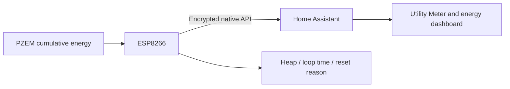

# ESPHome Meter Reliability

ESP8266 + PZEM-004T V3 电表通信与日电量可靠性实验项目。

**状态：实验性源码，不是已完成长期验收的稳定版固件。**
本仓库只发布脱敏模板、原创日结辅助代码、测试和说明，不提供预编译刷机包。



## 修复范围

- 无 API 客户端连接超过 15 分钟时重启通信模块，提供网络假连接后的恢复兜底。
- 明确关闭无线省电和主动漫游，降低无用日志及网页日志连接负担，保留每秒计量。
- 日结状态持久化，但不每秒修改持久化数据；不会调用累计电量清零接口。
- 处理首次启动无基线、NaN、计数回退、跨日缺测、过期读数与明显时间回拨。
- 容忍同日 1～2 秒的小幅校时；日界以午夜前后 10 秒内的有效观测采样为基准。
- 今日/昨日电量不冒充只增累计量，无法可靠计算时显示未知，不伪造缺测数据。
- IP 诊断读取站点接口地址，不将恢复热点的地址当作正常服务地址。
- 增加每分钟堆内存、碎片率、循环耗时和重启原因诊断。
- 公开模板默认启用 API 加密、OTA 密码与受保护的恢复热点；不启用普通网页管理，节约 1 MB 板的 OTA 空间。

## 支持边界

模板针对 `esp01_1m`、UART TX GPIO1 / RX GPIO3、PZEM-004T V3，
默认不启用可选温度探头和普通网页管理，以保留小闪存板的 OTA 余量。
**这不是所有电表都能直接刷入的通用固件。**
请先核对板型、闪存、接线定义及恢复方式；增加组件后必须重新核对固件大小和 OTA 空间。
任何涉及配电箱和市电接线的工作均应由合格人员处理，不要带电拆接。

默认时区为 Asia/Shanghai，日结辅助代码也按 UTC+8 计算日期；其他时区需要同时调整并重新测试。
它不是贸易结算级计量方案，不替代供电公司的正式账单。

## 开始使用

建议使用 Python 3.12，在本机独立环境构建：

```sh
python3 -m venv .venv
source .venv/bin/activate
pip install -r requirements.txt
python scripts/init_secrets.py
```

仅在本机填写生成的 `secrets.yaml` 中的 Wi-Fi 字段；脚本为其余管理入口生成独立随机密钥，
不会打印密钥，也不会覆盖已经存在的 secrets 文件。
修改 `meter.yaml` 的节点名、友好名称和硬件配置后，先校验再编译：

```sh
esphome config meter.yaml
esphome compile meter.yaml
```

**编译不等于刷写。** 上传前先保留现有配置、实体映射和可用恢复方案，再按
[ESPHome 官方 OTA 说明](https://esphome.io/components/esphome/ota/)执行。
编译产物含本机配网信息，不能作为脱敏文件公开上传。

新接入 Home Assistant 时填写生成的 API 加密密钥。现有明文连接直接改为加密会要求重新配置连接，
不要在没有准备配套更新时直接覆盖正在使用的设备。

## 电量与历史

Home Assistant 能源面板和 Utility Meter 应使用 **Energy 累计量**。
不要用每日复位的 Today Energy 替换累计总表，也不要为排障清零计量模块。
仓库不会自动修改 HA 配置、历史数据库、电价或账单。

首次启动当天，设备侧今日/昨日电量可能显示未知。这是缺少可信日结基线的保护：
完整观察有效日界后，今日量开始可计算；完整观察一天后，昨日电量才可用。
如果跨午夜长时间离线，不将多天累计增量随意分配给某一天。

## 检查与验证

```sh
c++ -std=c++17 -Wall -Wextra -Werror tests/daily_ledger_test.cpp -o /tmp/meter-ledger-test
/tmp/meter-ledger-test
python scripts/check_public_tree.py
```

- 原创日结辅助代码有 28 项主机边界断言；主机测试不等于电表实测。
- 同一核心逻辑的私有现场配置已接入 HA Core 2026.10.4，累计量连续、未清零。
- 公开模板默认使用加密、通用命名并省去普通网页管理，不能将私有配置的现场结果冒充公开模板的完整实机验收。
- 近一天后失联的初始触发点仍未确定；短时恢复、上传成功或编译成功不能证明永久修复。
- 待完成：跨午夜/24～48 小时观察、真实失联恢复、断电持久化与公开加密配置的实机验收。
- API 失联自动重启也会在 HA 停机较久时触发；它是恢复取舍，不是消除网络故障的保证。

## 反馈与安全

通过 Issues 提供版本、板型、复现步骤和脱敏后的少量错误摘要。
**不要提交 secrets.yaml、完整 HA 日志、固件文件、Wi-Fi 信息、设备标识或家庭用电记录。**
不要在公网暴露设备管理端口。安全问题不要在公开 Issue 中粘贴秘密。

## 许可

原创内容使用 MIT，依赖保留各自许可证，详见
[第三方告知](THIRD_PARTY_NOTICES.md)。仓库不包含厂家原始固件、原始配置或其文档图片。
